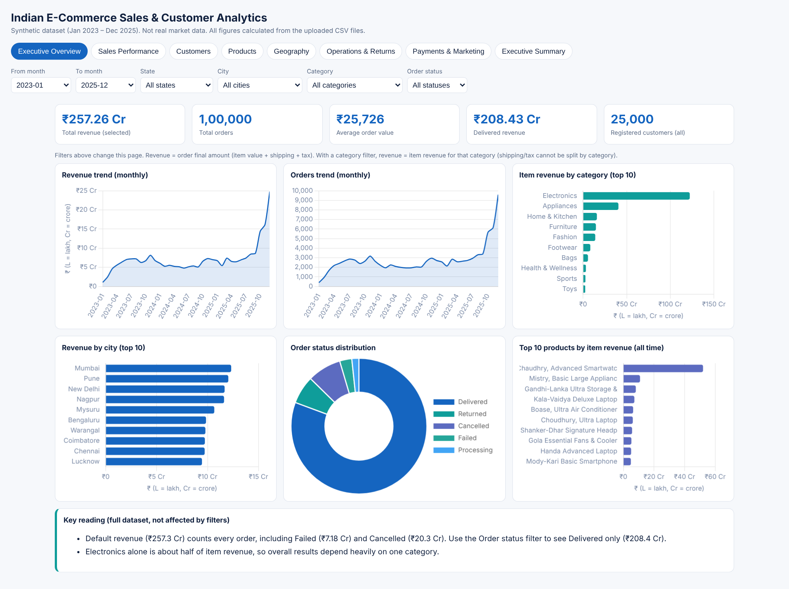

# Indian E-Commerce Sales & Customer Analytics

An interactive analytics dashboard (plus PDF report and Power BI handover) built on a **synthetic** Indian e-commerce dataset covering January 2023 to December 2025.



> **Important:** the data is simulated (Python, Pandas, NumPy, Faker). It is not real company data and the results are not real market statistics.

## Project overview
Eight-page interactive dashboard (seven analysis sections plus an executive summary) that shows sales, customers, products, geography, operations and returns, payments and marketing. Every number was recalculated from the source CSV files and checked against the dashboard in a headless browser.

## Problem statement
An online retailer needs one reliable view of performance: how much it sells, to whom and where, how well it delivers, how many orders come back, and whether campaigns appear to help. The challenge is to get the metrics right (statuses, double counting across one-to-many tables) and to be honest about data limits.

## Objectives
- Audit and validate nine linked tables.
- Define KPIs clearly and reconcile earlier EDA and Power BI figures.
- Build an interactive dashboard with working filters.
- Turn results into business recommendations.
Details: [documentation/PROJECT_OBJECTIVES.md](documentation/PROJECT_OBJECTIVES.md)

## Dataset
| | |
|---|---|
| Period | 2023-01-01 to 2025-12-31 |
| Geography | 15 states, 31 cities (India) |
| Tables | customers 25,000 · orders 1,00,000 · order_items 2,54,331 · products 550 · payments 1,00,000 · shipments 89,681 · returns 12,075 · customer_reviews 77,530 · marketing_campaigns 151 |
Full column list: [documentation/DATA_DICTIONARY.md](documentation/DATA_DICTIONARY.md). The raw CSVs (about 57 MB) are not committed; see [raw_data/README.md](raw_data/README.md).

## Tools and technologies
Python (Pandas) for audit and data preparation · JavaScript, HTML, CSS · Chart.js 4.4.1 (bundled, works offline) · Power BI (DAX, theme, model design) · ReportLab and Playwright (PDF report and screenshots).

## Analysis workflow
1. Inspect and audit all tables (keys, duplicates, nulls, formulas, relationships).
2. Define metrics and reconcile discrepancies.
3. Pre-aggregate data with `dashboard/src/build_data.py` (no double counting: order-grain and item-grain summaries are kept separate).
4. Build the dashboard and test it.
5. Write the report, documentation and recommendations.
Details: [documentation/ANALYSIS_METHODOLOGY.md](documentation/ANALYSIS_METHODOLOGY.md)

## Dashboard features
- 8 pages: Executive Overview, Sales Performance, Customers, Products, Geography, Operations & Returns, Payments & Marketing, Executive Summary.
- Filters (month range, state, city, category, order status) on Overview, Sales and Geography.
- Indian number formatting (₹, lakh, crore), tooltips, dark-mode aware, responsive layout.
- Works offline from a double-click.

## Key business insights (synthetic data)
- Total order value ₹257.26 Cr from 1,00,000 orders (average ₹25,726); Delivered only: ₹208.43 Cr.
- 2025 revenue is 74% above 2024 because of more orders, not higher order value; Q4 is the strongest quarter every year.
- Electronics is about half of item revenue; one product is about 21%.
- 82.4% of buyers are repeat customers, yet 53.5% of customers are labelled Churned; the top 10% of buyers bring 38.6% of revenue.
- 42.8% of delivered shipments are late; return rate is 10.9%, led by Fashion and Footwear.
- UPI leads payments (32.0%); campaigns are tied to 17.2% of orders (attribution, not proven ROI).
- The 2,880-order gap in the customer analysis equals the Failed orders exactly.
More: [documentation/KEY_FINDINGS.md](documentation/KEY_FINDINGS.md) and [documentation/BUSINESS_RECOMMENDATIONS.md](documentation/BUSINESS_RECOMMENDATIONS.md). Full PDF: [reports/Indian_Ecommerce_Dashboard_Report.pdf](reports/Indian_Ecommerce_Dashboard_Report.pdf)

## Limitations
Synthetic data; some unresolved source inconsistencies (returns vs order status, refunds, delivery_days); pre-aggregated filters; no lifetime value, forecasting or true marketing ROI. See [documentation/LIMITATIONS_AND_ASSUMPTIONS.md](documentation/LIMITATIONS_AND_ASSUMPTIONS.md).

## How to run or view the dashboard
- **Locally:** download or clone the repository and double-click `index.html`. No installation or internet is needed.
- **With a local server (optional):** `python -m http.server 8000` in this folder, then open http://localhost:8000
- **Online:** enable GitHub Pages (Settings → Pages → Deploy from branch → `main` → `/ (root)`). Your link will be `https://YOUR-USERNAME.github.io/REPOSITORY-NAME/`.
- **Rebuild the data (optional):** put the CSVs in `raw_data/`, run `pip install pandas` then `python dashboard/src/build_data.py raw_data`.

## Repository structure
```
Indian-Ecommerce-Sales-Customer-Analytics/
├── README.md
├── index.html                  # dashboard entry page
├── dashboard_preview.png
├── LICENSE
├── .gitignore
├── dashboard/
│   ├── assets/                 # styles.css, app.js, chart.umd.js (Chart.js), license
│   ├── data/data.js            # summarised data used by the dashboard
│   └── src/build_data.py       # rebuilds data.js from the CSVs
├── reports/
│   └── Indian_Ecommerce_Dashboard_Report.pdf
├── documentation/              # objectives, data dictionary, methodology, findings, limitations, recommendations
├── powerbi/                    # DAX_Measures.txt, Theme.json, AUDIT_AND_MODEL.md
└── raw_data/                   # place source CSVs here (not committed)
```

## Author
Saumil Dodiya, BSc Data Science. Licensed under MIT (see `LICENSE`).
